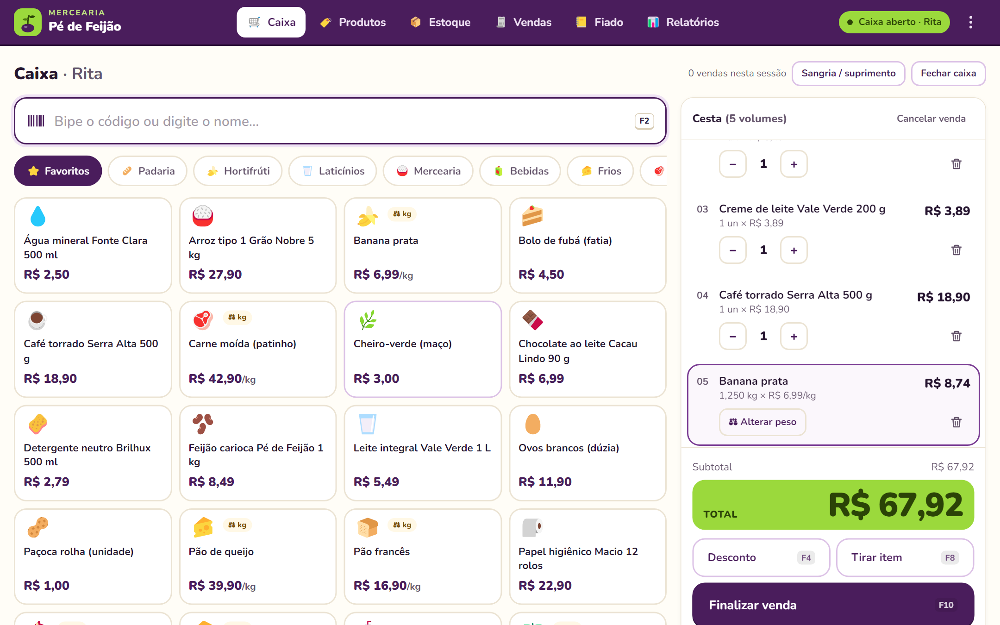
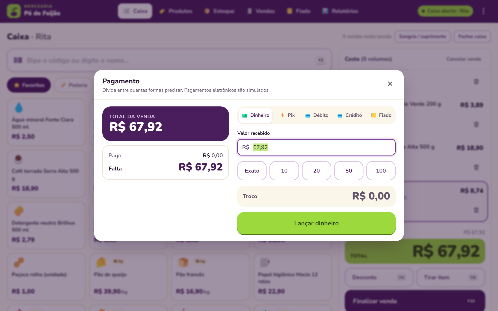
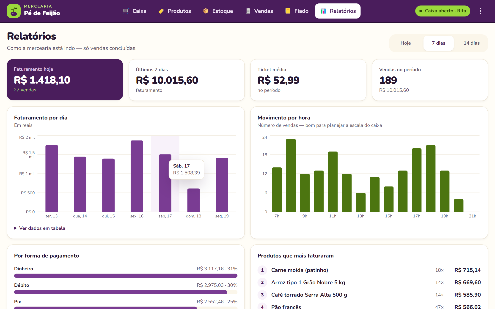

# 🫘 PDV Mercearia Pé de Feijão

Frente de caixa (PDV) para uma mercearia de bairro, feita em **React 19 + TypeScript**. O operador bipa ou digita produtos, pesa itens a granel, aplica descontos, divide o pagamento entre dinheiro, Pix, cartão e fiado, imprime o cupom e fecha o caixa no fim do dia, conferindo o esperado contra o contado. Em volta do caixa há catálogo com validação de EAN-13, controle de estoque, histórico de vendas com cancelamento, caderneta de fiado e um painel de relatórios. O projeto mostra como transformar regras de negócio de verdade (troco, limite de crédito, sangria, estoque) numa interface rápida, acessível e pensada para tablet e teclado.

> ⚠️ **Projeto de portfólio.** A mercearia, os produtos, os clientes e as vendas são **fictícios**. Pix, cartão e "leitura da balança" são **simulados** com Promises: **nenhum pagamento real é processado**.

**Demo:** https://ppena23.github.io/pdv-mercearia-react/

| Caixa | Pagamento | Relatórios |
|---|---|---|
|  |  |  |

## Funcionalidades

**Caixa (`/caixa`)**
- Campo único de busca sempre focado: nome, código EAN (Enter simula o leitor de código de barras), multiplicador `3*7898…` e peso `0,532*2000…`.
- Itens vendidos por kg abrem o diálogo de pesagem (digitar `0,532`, atalhos 250 g/500 g/1 kg ou "ler balança" simulada).
- Grade de acesso rápido com favoritos e abas por categoria, com botões grandes para toque.
- Cesta com +/−, remoção com **Desfazer** (toast), desconto por item ou na venda (R$ ou %). Acima de 20% pede autorização do gerente.
- Pagamento **dividido**: dinheiro (troco + notas rápidas), Pix (QR Code SVG fictício + confirmação assíncrona), débito/crédito (maquininha simulada: insira → senha → processando → aprovado/recusado ~10%) e fiado (bloqueia acima do limite).
- Cupom não fiscal em estilo bobina térmica de 80 mm, com impressão via `window.print()` e CSS de impressão.
- Sessão de caixa: abertura com troco inicial, sangria/suprimento (não deixa retirar mais do que há na gaveta) e fechamento com **esperado × contado** por forma de pagamento.

**Outras telas**
- `/produtos`: CRUD com formulário validado (EAN-13 com dígito verificador, código único, preço, un/kg, estoque mínimo, favorito). Os filtros ficam na URL.
- `/estoque`: alertas de estoque baixo/zerado, botão "Repor" e entrada de mercadoria. Vendas baixam o estoque e cancelamentos devolvem.
- `/vendas`: histórico agrupado por dia, com filtros (datas, forma, situação), detalhe com cupom, reimpressão e cancelamento.
- `/clientes-fiado`: limite, saldo devedor, extrato e recebimento.
- `/relatorios`: faturamento do dia/semana, ticket médio, vendas por dia e por hora, formas de pagamento e top produtos.
- Página 404 e menu "Demonstração" (⋮) para restaurar os dados ou **simular instabilidade de rede** e ver os estados de erro.

## Atalhos de teclado

| Tecla | Ação |
|---|---|
| `F2` | Focar a busca de produto |
| `F4` | Desconto (item selecionado ou venda) |
| `F8` | Cancelar (tirar) o item selecionado |
| `F10` | Finalizar venda / abrir pagamento |
| `Esc` | Fechar o diálogo aberto |
| `Enter` | Adicionar o produto buscado / confirmar |
| `↑` `↓` | Navegar nas sugestões da busca |
| `←` `→` | Trocar de aba (categorias, formas de pagamento) |
| `3*código` | Lança 3 unidades do código |

Tudo também funciona por clique/toque.

## Conceitos de React aplicados → onde no código

| Conceito | Onde |
|---|---|
| Componentes e composição | `src/components/ui/*` (design system), `features/caixa/TelaCaixa.tsx` compõe Busca + Grade + Lista + diálogos |
| Props e tipagem genérica | `components/ui/Tabs.tsx` (`Tabs<T extends string>`), `components/ui/Button.tsx` (variantes, `ref` como prop do React 19) |
| Estado com `useReducer` + ações tipadas | `features/caixa/carrinhoReducer.ts`, `store/dadosReducer.ts`, `store/caixaReducer.ts` (uniões discriminadas) |
| Context (store global) | `store/DadosProvider.tsx` (estado e ações em contextos separados), `store/CaixaProvider.tsx`, `components/ui/Toast.tsx` |
| Custom hooks | `hooks/useCarrinho.ts`, `useCaixa.ts`, `useAtalhos.ts`, `useDebounce.ts`, `useLocalStorage.ts`, `useTituloPagina.ts` |
| Efeitos, ciclo de vida e limpeza | `components/ui/Dialog.tsx` (foco preso, devolve o foco, trava a rolagem), `pagamento/paineis.tsx` (AbortController ao desmontar), `hooks/useDebounce.ts` |
| Error Boundary (ciclo de vida de classe) | `components/layout/LimiteErro.tsx` |
| Eventos e teclado | `hooks/useAtalhos.ts` (F2/F4/F8/F10), `features/caixa/BuscaProduto.tsx` (combobox com setas/Enter/Esc) |
| Formulários + validação (RHF + Zod) | `features/produtos/produtoSchema.ts` (refinamento do dígito EAN-13, unicidade, validação entre campos), `caixa/AberturaCaixa.tsx`, `caixa/MovimentoDialog.tsx`, `caixa/FechamentoPage.tsx`, `clientes/dialogos.tsx`, `estoque/EstoquePage.tsx` |
| Rotas aninhadas, params e search params | `App.tsx` (HashRouter, layout raiz, `/produtos/:produtoId` e `/vendas/:vendaId` como diálogos sobre a lista, 404), filtros em `useSearchParams` |
| Code splitting | `App.tsx` (`lazy` + `Suspense` em todas as rotas fora do caixa; Recharts só em Relatórios) |
| `memo` / `useMemo` / `useCallback` | `caixa/GradeRapida.tsx` e `ListaCarrinho.tsx` (`memo`), totais em `useCarrinho.ts`, agregações em `RelatoriosPage.tsx` |
| async/await e Promises | `services/api.ts` + `services/rede.ts` (API fictícia com atraso), `services/maquininha.ts` (`Promise.race` no Pix), `store/DadosProvider.tsx` |
| UX: loading, vazio, erro, feedback | `components/layout/ComDados.tsx` (skeleton/erro/tentar de novo), `EmptyState`, toasts com "Desfazer", botões com `carregando` |
| Acessibilidade | `aria-live` na cesta e nos pagamentos, `role="combobox"`/`listbox`, abas WAI-ARIA, foco visível, `prefers-reduced-motion`, link "Pular para o conteúdo" |
| Testes | `src/lib/regras.test.ts` (Vitest) |

## Por que o dinheiro é guardado em centavos?

Em JavaScript, `0.1 + 0.2 === 0.30000000000000004`. Num caixa, esse erro aparece no troco e no fechamento. Por isso **todo valor monetário é um inteiro em centavos** (`1290` = R$ 12,90): soma e subtração ficam exatas, e o arredondamento acontece num único lugar (`multiplicar` para preço × kg e `percentual` para descontos, em `src/lib/money.ts`). A conversão para "R$ 12,90" só acontece na exibição, com `Intl.NumberFormat`. Seguindo a mesma ideia, peso é guardado em **gramas inteiras**.

## Stack

- **React 19** + **TypeScript** (strict) + **Vite**
- **React Router 7** (HashRouter, para funcionar no GitHub Pages)
- **React Hook Form** + **Zod** para formulários e validação
- **Tailwind CSS v4** com design tokens em CSS (`src/index.css`, bloco `@theme`)
- **Recharts** nos relatórios
- **Vitest** para testes das regras de negócio
- Persistência em `localStorage` por meio de uma API fictícia assíncrona (`src/services`)

## Como rodar

```bash
npm install
npm run dev      # http://localhost:5173/pdv-mercearia-react/
npm test         # testes das regras de negócio (Vitest)
npm run build    # tsc -b && vite build -> dist/
```

## Estrutura de pastas

```
src/
├── App.tsx                 # rotas (HashRouter, layout aninhado, lazy, 404)
├── main.tsx                # providers: Toast → Dados → Caixa
├── index.css               # design tokens (@theme), foco, reduced motion, CSS de impressão
├── types/dominio.ts        # Produto, Venda, Pagamento, Cliente, SessaoCaixa…
├── lib/                    # regras puras e testáveis
│   ├── money.ts            #   centavos, parse/format BRL, peso em gramas
│   ├── ean.ts              #   dígito verificador EAN-13
│   ├── scanner.ts          #   "3*789…", "0,532*…", busca sem acento
│   ├── carrinho.ts         #   totais com desconto por item e geral
│   ├── pagamento.ts        #   troco, pagamento dividido, limite do fiado
│   ├── caixa.ts            #   esperado × contado no fechamento
│   ├── relatorios.ts       #   agregações dos gráficos
│   └── regras.test.ts      #   testes (Vitest)
├── services/               # back-end FICTÍCIO: api.ts, db.ts (localStorage), rede.ts (latência/falhas), maquininha.ts
├── data/                   # catálogo semente (120 produtos) e gerador de 2 semanas de vendas
├── store/                  # Context + useReducer (dados do negócio e sessão de caixa)
├── hooks/                  # useCarrinho, useCaixa, useAtalhos, useDebounce, useLocalStorage…
├── components/
│   ├── ui/                 # design system: Button, Input/Select, Dialog, Tabs, Toast, Badge, Card, Kbd, Skeleton, EmptyState…
│   └── layout/             # AppLayout, ComDados (loading/erro), LimiteErro (Error Boundary), Logo
├── features/
│   ├── caixa/              # tela do PDV, busca, grade, cesta, diálogos, cupom, fechamento
│   │   └── pagamento/      # diálogo de pagamento e painéis (dinheiro, Pix, cartão, fiado)
│   ├── produtos/           # lista + formulário em rota aninhada + schema Zod
│   ├── estoque/            # alertas e entrada de mercadoria
│   ├── vendas/             # histórico + detalhe em rota aninhada
│   ├── clientes/           # caderneta do fiado
│   └── relatorios/         # dashboard (carregado sob demanda)
└── pages/NaoEncontrada.tsx # 404
```

---

Feito por **Pedro Pena** · [LinkedIn](https://www.linkedin.com/in/pedropena23/) · [GitHub](https://github.com/PPena23)
